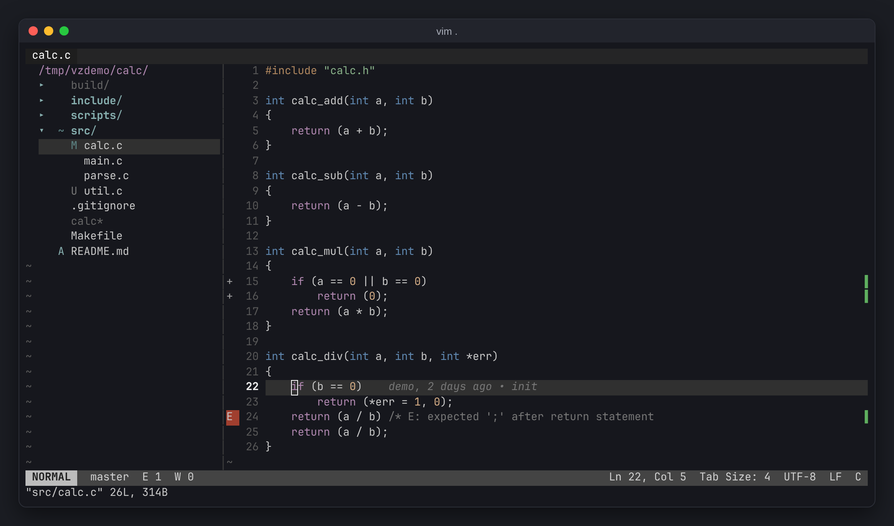
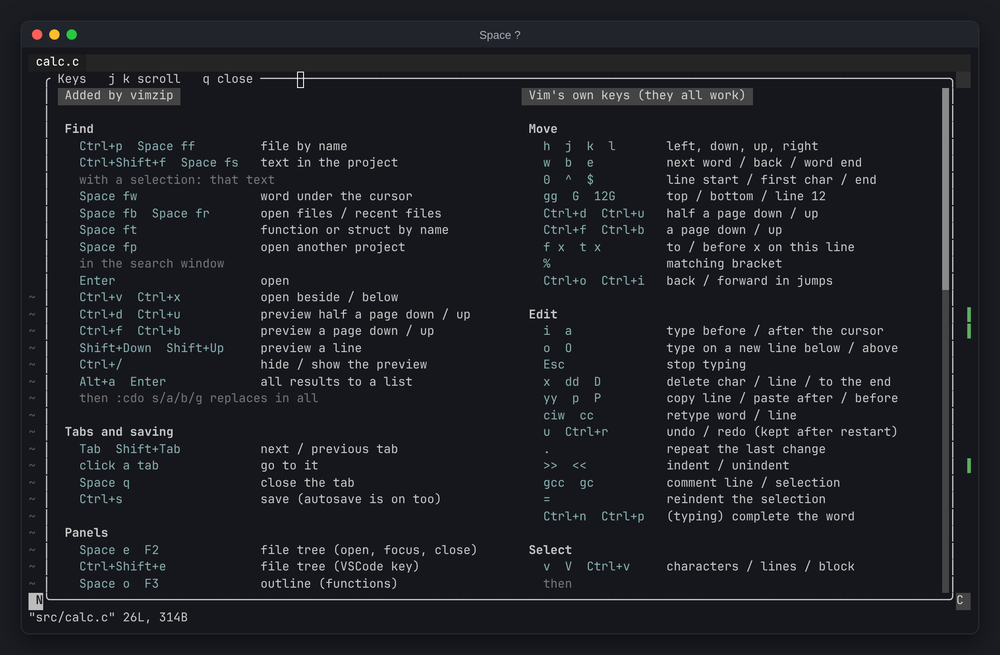

# vimzip

A VSCode-like vim for any x86-64 Linux. One archive, no root, no dependencies: every binary is
statically linked, so it runs regardless of the glibc version.



## Install

```sh
curl -fsSL https://github.com/PfClaKr/vimzip/releases/latest/download/vimzip-linux-x86_64.tar.gz | tar -xz -C ~
~/vimzip/install.sh
source ~/.bashrc    # or ~/.zshrc
```

This unpacks to `~/vimzip`, links `~/.local/bin/vim` and sets `EDITOR=vim`.

## Use

```sh
cd myproject
vim .
```

Opens the file tree and the files you had open last time. Files save themselves.

- **Find**: files (`Ctrl+p`), text in the project (`Ctrl+Shift+f` / `Space fs`), symbols; replace in
  the project with every change listed to check first (`Ctrl+Shift+h` / `Space fc`)
- **Code**: errors as you save, go to definition (`gd`, system headers too), completion (`Ctrl+n`
  while typing), rename everywhere (`Space cr`), format (`Space cf`), quick fixes (`Ctrl+.` /
  `Space ca`), the problems of the open files in one list (`Space cp`, or click `E`/`W` in the status
  bar), build (`Ctrl+Shift+b` / `Space cb`: CMake, make, cargo, go, zig or npm; errors join the problems)
- **Edit**: several places at once: `Ctrl+n` on a word picks it and each `Ctrl+n` more the next one
  (VSCode's `Ctrl+d`), then `c` retypes them all
- **Git**: status, line blame, file history, a timeline under the tree, change marks at the window
  edge, merge conflicts colored with a key for each choice (`Space mc` / `mi` / `mb`)
- **Panels**: terminal (`F4`), outline (`F3`), an AI agent on the right (`Space a`)
- **Debug**: gdb with breakpoints (`F5`, `F9`, `F10`, `F11`)
- **Images and PDFs**: open like any file; pictures are drawn in the window, PDFs show their text
  (`pdftotext` is used when installed), and `o` opens the file in the system viewer

Vim's own keys all work. The added ones are grouped under `Space` by topic (`f` find, `g` git,
`c` code, `t` terminal, `d` debug). **`Space ?` shows every key and `:` command.**



## Configure

`~/.config/vimzip/vimrc` is read last. For example:

```vim
let g:vimzip_theme = 'nord'   " gray (default), gruvbox, nord, tokyonight, minimal, vimgreen, vscode
let g:vimzip_ai = 'codex'     " default: the first of claude, codex, gemini, aider, opencode found
```

On a small machine (under 2 CPUs or 1 GB of free memory, container limits included) vimzip runs
light: less work in the background, line blame off until `Space gb`. `:VimzipInfo` shows what it
found; `let g:vimzip_lite = 0` (or `1`) decides for it.

`Space fp` lists your projects: the ones you added (`Ctrl+a` adds the typed folder, or opens a
folder tree to pick one with `a`; `Ctrl+e` edits the list, `~/.config/vimzip/projects`), then the
recently opened ones; `Ctrl+x` takes one off.

`:Theme` lists the status bar themes and `:Theme nord` tries one. Code is colored like VSCode's
Dark+ (functions, variables, types and constants apart); `colorscheme habamax` (or any other) in
the vimrc gives vim's own look.

Language servers give errors, `gd`, `gr`, `K` and completion (`Ctrl+x Ctrl+o`). vimzip uses one
when it is installed: clangd (C/C++), rust-analyzer, pyright or pylsp (Python), gopls, dart (Dart
and Flutter), tsserver (TypeScript/JS), lua-language-server, bash-language-server, zls and
cmake-language-server (CMakeLists.txt). `:Lsp` (or `Space cl`) lists them and turns one on or off;
`:Lsp rust off` does it directly, and the choice is kept. Defaults can go in the vimrc:
`let g:vimzip_lsp = {'python': 'pylsp', 'go': 0}`.

Saving (`Ctrl+s`, `:w`; not the autosave while typing) formats the file when the project has its
formatter's settings (`.clang-format`, `.prettierrc`, `rustfmt.toml`, `[tool.ruff]` or `[tool.black]`
in `pyproject.toml`...), and Go and Zig files always; `let g:vimzip_format_on_save = 0` (or `1`:
whenever a formatter is installed) decides for it. `let g:vimzip_build = 'make debug'` sets the build
command.

C/C++ projects built with CMake get their include paths and defines from it: when the project has
no `compile_commands.json` of its own, vimzip configures it in the background (into its cache, the
project folder stays as it is) the first time a C/C++ file opens, and again after a `CMakeLists.txt`
is saved. If CMake fails (a missing package), the project's folders with headers are used instead
and `:CMake` tries again; so are they for projects without CMake (as VSCode's default include path
does). A project's own `compile_commands.json` always comes first. `let g:vimzip_cmake = 0` turns
this off.

## Update and uninstall

```sh
rm -rf ~/vimzip && curl -fsSL https://github.com/PfClaKr/vimzip/releases/latest/download/vimzip-linux-x86_64.tar.gz | tar -xz -C ~
rm -rf ~/vimzip ~/.local/bin/vim ~/.cache/vimzip    # uninstall; also remove the '# vimzip' lines from ~/.bashrc
```

Undo history, sessions and tags live in `~/.cache/vimzip`. Entries unused for 90 days (tags, words)
or a year (undo, sessions) are removed automatically; `:VimzipInfo` shows the size.

## Compared to VSCode

| | vimzip | VSCode + C/C++ extension |
|---|---|---|
| Download | 22 MB | 357 MB |
| Installed | 77 MB | 1,033 MB |
| On an SSH server | the same 77 MB | VS Code Server 283 MB + extensions |
| Server needs | any x86-64 Linux | glibc 2.28+ |

`vim .` starts in about 0.15 s and uses about 18 MB of memory, about 0.23 s on LLVM (190,000 files).

## What's inside

vim (static musl build), ripgrep, fzf, universal-ctags, shellcheck, vimzip-view (pictures and PDF
text, in `tools/`), and the plugins ALE, fugitive, gitgutter, gv.vim, NERDTree with
nerdtree-git-plugin, fzf.vim, gutentags, tagbar, lightline and lightline-bufferline.

## Build

```sh
git clone --recursive https://github.com/PfClaKr/vimzip && cd vimzip
./build.sh                # on Alpine
CC=musl-gcc ./build.sh    # elsewhere (needs musl-tools)
```

Versions are pinned in `versions.env`. A weekly workflow opens a pull request with newer ones, and
every push to main publishes a release. `patches/vim` holds crash fixes vim does not have yet.
