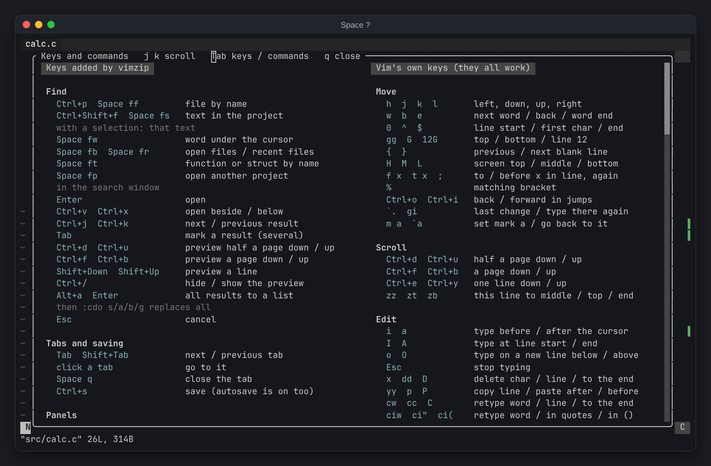

# vimzip

A VSCode-like vim for any x86-64 Linux. One archive, no root, no dependencies: every binary is
statically linked, so it runs regardless of the glibc version.


## Install

```sh
curl -fsSL https://github.com/PfClaKr/vimzip/releases/latest/download/vimzip-linux-x86_64.tar.gz | tar -xz -C ~
~/vimzip/install.sh
source ~/.bashrc    # or ~/.zshrc
```

This unpacks to `~/vimzip`, links `~/.local/bin/vim` and sets `EDITOR=vim`.

## Use

```sh
cd myproject
vim .
```

Opens the file tree and the files you had open last time. Files save themselves.

- **Find**: files (`Ctrl+p`), text in the project (`Ctrl+Shift+f` / `Space fs`), symbols
- **Code**: errors as you save, go to definition (`gd`, system headers too), completion (`Ctrl+n`)
- **Git**: status, line blame, file history, a timeline under the tree, change marks at the window edge
- **Panels**: terminal (`F4`), outline (`F3`), an AI agent on the right (`Space a`)
- **Debug**: gdb with breakpoints (`F5`, `F9`, `F10`, `F11`)

Vim's own keys all work. The added ones are grouped under `Space` by topic (`f` find, `g` git,
`c` code, `t` terminal, `d` debug). **`Space ?` shows every key and `:` command.**



## Configure

`~/.config/vimzip/vimrc` is read last. For example:

```vim
let g:vimzip_theme = 'nord'   " gray (default), gruvbox, nord, tokyonight, minimal, vimgreen, vscode
let g:vimzip_ai = 'codex'     " default: the first of claude, codex, gemini, aider, opencode found
```

`:Theme` lists the status bar themes and `:Theme nord` tries one. With clangd installed it is used
for errors and definitions. For CMake projects, `cmake -B build -DCMAKE_EXPORT_COMPILE_COMMANDS=ON`
gives both the build's include paths.

## Update and uninstall

```sh
rm -rf ~/vimzip && curl -fsSL https://github.com/PfClaKr/vimzip/releases/latest/download/vimzip-linux-x86_64.tar.gz | tar -xz -C ~
rm -rf ~/vimzip ~/.local/bin/vim    # uninstall; also remove the '# vimzip' lines from ~/.bashrc
```

## Compared to VSCode

| | vimzip | VSCode + C/C++ extension |
|---|---|---|
| Download | 21 MB | 357 MB |
| Installed | 74 MB | 1,033 MB |
| On an SSH server | the same 74 MB | VS Code Server 283 MB + extensions |
| Server needs | any x86-64 Linux | glibc 2.28+ |

`vim .` starts in about 0.15 s and uses about 18 MB of memory, about 0.23 s on LLVM (190,000 files).

## What's inside

vim (static musl build), ripgrep, fzf, universal-ctags, shellcheck, and the plugins ALE, fugitive,
gitgutter, gv.vim, NERDTree with nerdtree-git-plugin, fzf.vim, gutentags, tagbar, lightline and
lightline-bufferline.

## Build

```sh
git clone --recursive https://github.com/PfClaKr/vimzip && cd vimzip
./build.sh                # on Alpine
CC=musl-gcc ./build.sh    # elsewhere (needs musl-tools)
```

Versions are pinned in `versions.env`. A weekly workflow opens a pull request with newer ones, and
every push to main publishes a release.
