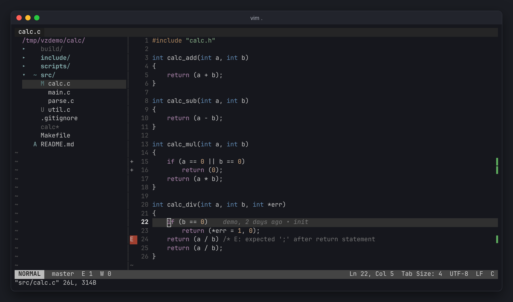
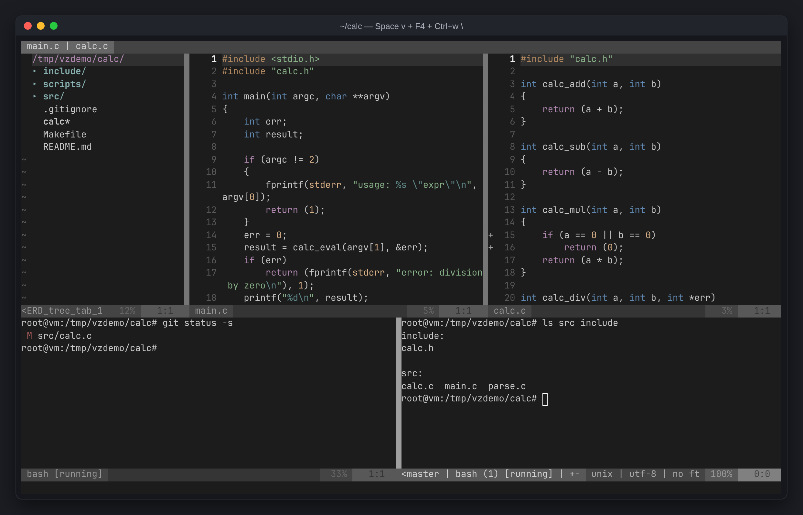
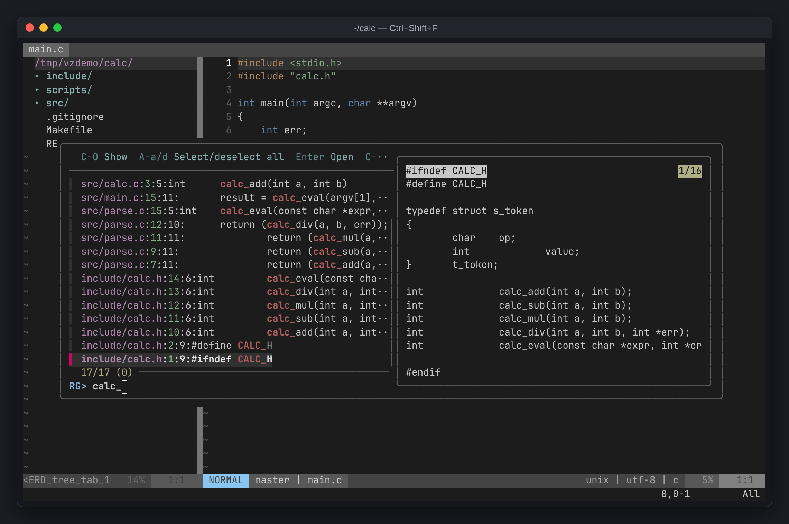
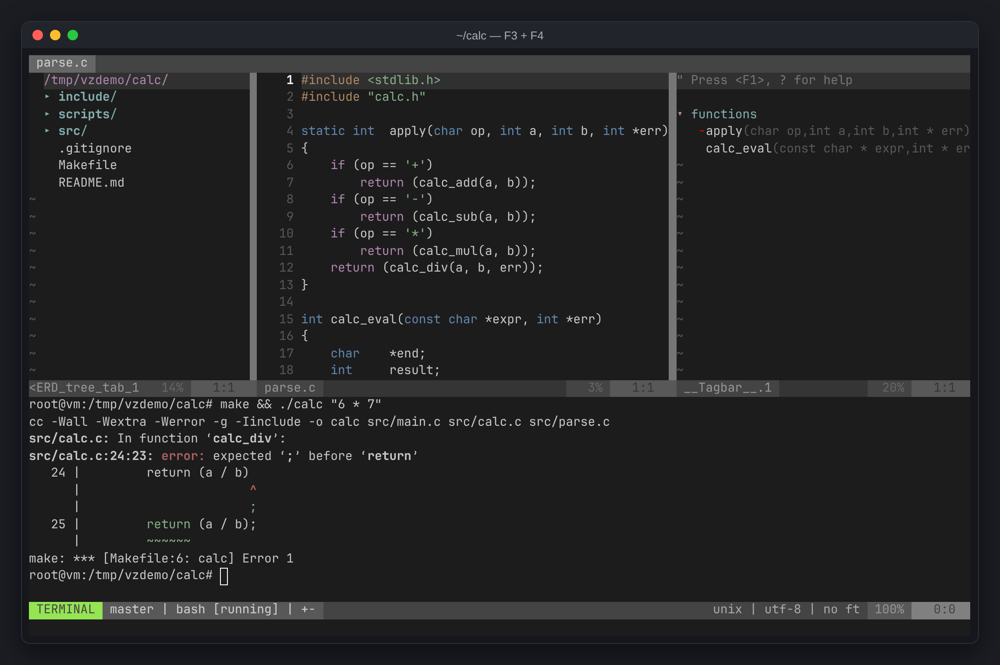
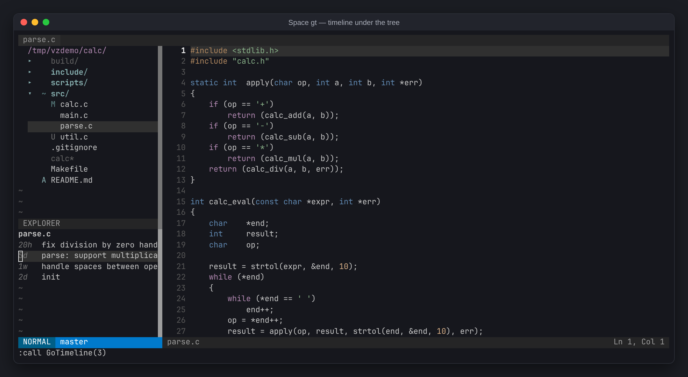
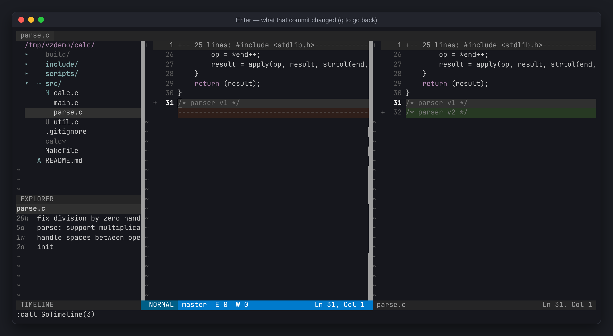

# vimzip

압축만 풀면 쓰는 리눅스 x86-64용 vim 개발 환경. 모든 바이너리가 정적 링크라 glibc 버전과 상관없이 동작합니다.

## 설치

```sh
curl -fsSL https://github.com/PfClaKr/vimzip/releases/latest/download/vimzip-linux-x86_64.tar.gz | tar -xz -C ~
~/vimzip/install.sh
source ~/.bashrc    # zsh는 ~/.zshrc
```

`~/vimzip`에 풀고, `~/.local/bin/vim`으로 연결하고, `EDITOR=vim`을 설정합니다. root 권한은 필요 없습니다.

## 사용

```sh
cd myproject
vim .
```

`vim .`은 파일 트리와 편집기를 열고, 그 폴더에서 마지막으로 열었던 파일을 복원합니다. 다른 프로젝트는 `Space fp`(최근 프로젝트 목록)나 `:Project 경로`로 vim 안에서 바로 바꿀 수 있습니다. 파일은 자동 저장됩니다 (편집 모드를 나갈 때, 수정 직후, 다른 파일·창으로 옮길 때).



업데이트와 삭제:

```sh
rm -rf ~/vimzip && curl -fsSL https://github.com/PfClaKr/vimzip/releases/latest/download/vimzip-linux-x86_64.tar.gz | tar -xz -C ~
```

```sh
rm -rf ~/vimzip ~/.local/bin/vim    # ~/.bashrc의 '# vimzip' 줄도 지우세요
```

## 포함

- vim (musl 정적 빌드), ctags, fzf, shellcheck, ripgrep
- ALE, gutentags, tagbar, fzf.vim, nerdtree, nerdtree-git-plugin, gitgutter, fugitive, gv.vim, lightline, lightline-bufferline

## VSCode와 비교

| | vimzip | VSCode + C/C++ 확장 |
|---|---|---|
| 다운로드 | 21 MB | 357 MB (215 + 142) |
| 설치 후 크기 | 74 MB | 1,033 MB (632 + 401) |
| SSH 서버에 올라가는 것 | 74 MB 전부 | VS Code Server 283 MB + 확장 |
| 서버 요구 사항 | x86-64 리눅스면 어디나 | glibc 2.28 이상 |

vimzip은 C 파일을 열고 트리, 에러 검사, git 표시가 모두 켜진 상태에서 약 70 ms에 뜨고 메모리 약 30 MB를 씁니다. VSCode 쪽은 같은 소스로 빌드한 VSCodium 1.143과 cpptools 1.35의 파일 크기입니다. LLVM(파일 19만 개)을 열어도 `vim .`은 약 0.14초, 메모리는 약 31 MB입니다.

## 단축키

규칙은 세 가지입니다.

- vim에 같은 일을 하는 키가 있으면 그 키를 씁니다 (`gd`, `gr`, `K`, `]c`, `]e`, `Ctrl+w …`, `:q`).
- VSCode의 F키와 `Ctrl+…` 키도 그대로 씁니다 (`F2`~`F12`, `Ctrl+p`, `Ctrl+Shift+f`).
- 나머지는 `Space` + 분류 글자입니다: `f` 찾기, `g` Git, `c` 코드, `t` 터미널, `d` 디버그.

`Space ?`를 누르면 한 화면에 모아서 보여줍니다.

### 찾기 (`Space f`)

| 키 | 기능 |
|---|---|
| `Ctrl+p` / `Space ff` | 파일 이름 검색 |
| `Ctrl+Shift+f` / `Space fs` | 프로젝트 전체 텍스트 검색 (선택한 상태면 그 글자로) |
| `Space fw` | 커서 아래 단어로 전체 검색 |
| `Space fb` / `Space fr` | 열린 파일 / 최근 파일 |
| `Space ft` | 심볼(함수, 구조체) 검색 |
| `Space fp` / `:Project 경로` | 다른 프로젝트 열기 (최근 목록, 탭 복원) |
| 검색 창에서 `Enter` / `Ctrl+v` / `Ctrl+x` | 열기 / 세로 분할 / 가로 분할로 열기 |
| `/단어` → `n` / `N`, `*` | 현재 파일에서 찾기 → 다음 / 이전, 커서 아래 단어 |
| `:%s/old/new/g` | 현재 파일에서 바꾸기 |
| 전체 검색에서 `Alt+a` → `Enter` → `:cdo s/old/new/g` | 프로젝트 전체에서 바꾸기 |

### 탭과 저장

| 키 | 기능 |
|---|---|
| `Tab` / `Shift+Tab` / 탭 클릭 | 다음 / 이전 탭 / 그 탭으로 |
| `:q` / `ZZ` / `Space q` | 현재 탭 닫기 (마지막 탭의 `:q`는 vim 종료) |
| `:q!` / `ZQ` | 저장하지 않고 탭 닫기 |
| `:qa` | vim 종료 |
| `Ctrl+s` | 저장 (자동 저장도 켜져 있음) |

### 패널

| 키 | 기능 |
|---|---|
| `Space e` / `F2` / `Ctrl+Shift+e` | 파일 트리 (닫혀 있으면 열기, 다른 창이면 트리로, 트리에서는 닫기) |
| `Space o` / `F3` | 함수 목록 (`Enter`로 이동) |
| `Space tt` / `F4` | 아래 터미널 패널 (숨겨도 계속 실행) |
| `Space a` / `Ctrl+Alt+i` | 오른쪽 AI 에이전트 (숨겨도 계속 실행) |

### 창 (vim의 `Ctrl+w`)

| 키 | 기능 |
|---|---|
| `Ctrl+w s` / `Ctrl+w v` | 가로 / 세로 분할 |
| `Ctrl+h` `Ctrl+j` `Ctrl+k` `Ctrl+l` | 왼쪽 / 아래 / 위 / 오른쪽 창으로 (`Ctrl+w h` 등은 터미널 안에서도) |
| `Ctrl+w q` | 창 닫기 (마지막 편집 창이면 `:q`처럼 탭 닫기) |
| `Ctrl+w =` | 창 크기 균등하게 (트리·패널도 기본 크기로) |
| `Ctrl+w _` / `Ctrl+w \|` | 현재 창 높이 / 너비 최대로 |
| `Ctrl+w +` `-` `<` `>` | 높이 / 너비 조절 (경계선을 마우스로 끌어도 됨). 트리·패널 크기는 패널을 여닫아도 유지 |
| `Ctrl+w x` / `Ctrl+w H` `J` `K` `L` | 옆 창과 바꾸기 / 창을 맨 왼쪽·아래·위·오른쪽으로 |

### 터미널 (`Space t`)

| 키 | 기능 |
|---|---|
| `Space ts` / `Space tv` | 현재 창 아래 / 오른쪽에 새 터미널 |
| 터미널에서 `Ctrl+w s` / `Ctrl+w v` | 아래 / 오른쪽에 터미널 하나 더 |
| 터미널에서 `Ctrl+w N` → `i` | 스크롤·복사 모드 → 다시 입력 (마우스 휠도 가능) |
| 터미널에서 `Ctrl+w N` → 선택 → `y`/`Ctrl+c` → `i` → `Ctrl+v` | 복사해서 붙여넣기 (선택 중 `p`는 바로 붙여넣기) |
| 터미널에서 `Ctrl+w :` | vim 명령 입력 |
| `exit` | 터미널 닫기 |



### 코드 (`Space c`)

| 키 | 기능 |
|---|---|
| `gd` / `F12` | 정의로 이동 (`malloc` 같은 시스템 헤더 함수 포함, 여러 개면 번호로 선택) |
| `Ctrl+o` / `Ctrl+t` | 이동 전 위치로 돌아오기 |
| `gr` / `K` | 참조 찾기 / 설명 보기 (clangd 없으면 프로젝트 검색 / man 페이지) |
| `]e` / `[e` | 다음 / 이전 에러 |
| `Space ce` | 현재 줄 에러 자세히 (팝업) |
| `Space cf` | 파일 전체 자동 정렬 (선택 영역은 `=`) |
| `%` | 짝 괄호로 이동 |

### 파일 트리

트리는 지금 보고 있는 파일을 자동으로 펼쳐 가리키고, `.gitignore`에 걸린 파일·폴더는 흐리게 보입니다. 긴 이름은 `…`로 줄이고, 커서를 올리면 전체 이름이 위에 겹쳐 보입니다. 터미널이나 git으로 바뀐 파일도 바로 반영됩니다.

| 키 | 기능 |
|---|---|
| `Enter`·클릭 / `s` / `i` | 열기 / 세로 분할로 열기 / 가로 분할로 열기 |
| `m` | 파일 추가·이름 변경·삭제 메뉴 |
| `I` / `R` | 숨김 파일 표시 / 새로고침 |
| `C` / `u` | 선택한 폴더를 루트로 / 상위 폴더로 |
| `A` | 트리를 화면 전체 너비로 / 원래대로 |
| `M` `A` `U` `D` `R` `C` `~` | git 상태: 수정 / 스테이지 / 새 파일 / 삭제 / 이름 변경 / 충돌 / 안에 변경 있음 |

### 편집 (vim 그대로)

| 키 | 기능 |
|---|---|
| `u` / `Ctrl+r` | 실행 취소 / 다시 실행 (껐다 켜도 유지) |
| `gcc` / 선택 후 `gc` | 줄 / 선택 영역 주석 토글 |
| `yy` / `dd` / `p` | 줄 복사 / 잘라내기 / 붙여넣기 |
| `y` / 선택 후 `Ctrl+c` | 복사 (SSH 너머 로컬 클립보드로도, OSC 52 지원 터미널) |
| `>>` / `<<` | 들여쓰기 / 내어쓰기 |
| `Ctrl+n` / `Ctrl+p` | 자동완성: 열린 파일, 프로젝트 전체 단어, 함수 이름, include한 헤더 (자동 팝업은 꺼져 있음) |

### Git (`Space g`, GitLens처럼)

커서를 잠시 멈추면 그 줄의 마지막 커밋(작성자, 시간, 메시지)이 줄 끝에 흐리게 나옵니다.
창 오른쪽 끝(스크롤바 자리)에는 파일 전체의 변경 위치가 표시됩니다 (초록 추가, 파랑 수정, 빨강 삭제). 클릭하면 그 변경으로, 빈 곳을 클릭하면 파일의 그 위치로 이동합니다.

| 키 | 기능 |
|---|---|
| `Space gs` | 상태 창 (`s` 스테이지, `u` 취소, `=` diff, `cc` 커밋, `q` 닫기) |
| `Space gc` | 현재 줄 커밋 자세히 (팝업) |
| `Space gb` / `Space gB` | 줄 끝 커밋 표시 켜기·끄기 / 파일 전체 blame |
| `Space gh` / `Space gl` | 현재 파일 히스토리 (선택 영역은 그 줄들) / 전체 커밋 그래프 |
| `Space gt` | 트리 아래 타임라인 (`Enter`로 그 커밋의 변경 비교, `q`로 돌아오기) |
| `Space gd` | 지금 파일과 마지막 커밋 비교 |
| `]c` / `[c` | 다음 / 이전 변경 위치 |
| `Space gp` / `Space ga` / `Space gu` | 커서가 있는 변경 미리보기 / 스테이지 / 되돌리기 |

### AI 에이전트

설치된 claude, codex, gemini, aider, opencode 중 먼저 찾은 것을 `Space a`로 엽니다. 직접 정하려면:

```sh
export VIMZIP_AI=codex    # 인자도 가능: VIMZIP_AI="aider --model sonnet"
```

### 디버그 (`Space d`, gdb 필요)

| 키 | 기능 |
|---|---|
| `Space dd` / `F5` | 시작 (`./a.out 인자` 입력 후 바로 실행, 중단점에서 멈춤) / 계속 |
| `Space db` / `F9` | 중단점 토글 (시작 전에도 가능) |
| `Space dn` / `F10` | 다음 줄 |
| `Space di` / `F11` | 함수 안으로 |
| `Space do` / `Shift+F11` | 함수 밖으로 |

- `Ctrl+Shift+f`, `Ctrl+Shift+e`, `Ctrl+Alt+i`, F키는 터미널이 가로채면 동작하지 않습니다. 그때는 같은 일을 하는 `Space` 키를 쓰세요.
- 서버에 clangd가 있으면 정의 이동·에러 표시에 clangd를 씁니다.
- CMake 프로젝트는 `compile_commands.json`을 만들어 두면 에러 검사와 `gd`가 빌드와 같은 include 경로를 씁니다:

  ```sh
  cmake -B build -DCMAKE_EXPORT_COMPILE_COMMANDS=ON
  ```
- 개인 설정은 `~/.config/vimzip/vimrc`에 넣으면 마지막에 읽습니다.

## 상태바 색

`~/.config/vimzip/vimrc`에 한 줄 넣으면 됩니다. `:Theme`으로 목록 보기, `:Theme nord`로 바로 바꿔보기.

```vim
let g:vimzip_theme = 'gruvbox'
```

`gray`(기본), `gruvbox`, `nord`, `tokyonight`, `minimal`, `vimgreen`, `vscode`.
직접 만들려면 [`themes/`](themes)의 파일을 `~/.config/vimzip/themes/<이름>.vim`으로 복사해서 고치세요.

## 스크린샷

| 전체 검색 | 파일 검색 |
|---|---|
|  |  |
| **함수 목록 + 터미널** | **디버그** |
|  |  |
| **타임라인** | **타임라인에서 커밋 비교** |
|  |  |

## 빌드

```sh
git clone --recursive https://github.com/PfClaKr/vimzip && cd vimzip
./build.sh                # Alpine
CC=musl-gcc ./build.sh    # 그 외 (musl-tools 필요)
```

버전은 `versions.env`. 매주 자동으로 갱신 PR이 열리고, main에 들어가면 릴리스가 올라갑니다.
